<div align="center">


<br/>

# BALAJI MALI

### DATA SCIENCE · ARTIFICIAL INTELLIGENCE · MACHINE LEARNING


<br/>

<a href="https://github.com/malibalaji95">
  
</a>
<a href="https://www.linkedin.com/in/balaji-mali0905">
  
</a>

</div>

---

## `01` // SYSTEM PROFILE

<div align="center">



</div>

## `02` // ABOUT ME

```text
USER       : Balaji Mali
DOMAIN     : Data Science & Artificial Intelligence
FOCUS      : Machine Learning | Data Engineering
DEVELOPMENT: Python | Node.js | SQL
PLATFORM   : AWS | Docker | GitHub Actions
MINDSET    : Learn → Build → Experiment → Improve


I enjoy building practical software and AI solutions, exploring machine learning, and turning ideas into working projects. My interests span data science, backend engineering, and deploying applications using modern development tools.
- Exploring machine learning and AI applications.
- Working with data processing, analysis, and model development.
- Building APIs and backend services.
- Learning MLOps, containerization, and cloud deployment.
- Turning technical ideas into practical projects.
03 // CONTRIBUTION ACTIVITY
<div align="center">




<a href="https://github.com/malibalaji95?tab=repositories">
  
</a>

</div>

04 // TECHNOLOGY STACK
Languages
<div align="center">


</div>

Machine Learning & Data Science
<div align="center">


</div>

Backend & Databases
<div align="center">


</div>

Cloud, DevOps & Tools
<div align="center">


</div>

05 // AREAS OF INTEREST
<div align="center">

AREA	FOCUS
Artificial Intelligence	Building practical AI-powered applications
Machine Learning	Model training, evaluation, and experimentation
Data Science	Data analysis, feature engineering, and insights
Data Engineering	Data processing and database systems
Backend Development	APIs, server-side applications, and databases
MLOps	Model deployment, reproducibility, and automation
Cloud & DevOps	Docker, AWS, and CI/CD workflows


</div>

06 // FEATURED WORK
<div align="center">

<a href="https://github.com/malibalaji95?tab=repositories">
  
</a>

</div>

Explore my repositories for projects involving machine learning, AI applications, backend development, data processing, and deployment.
07 // CONNECT
<div align="center">

<a href="https://github.com/malibalaji95">
  
</a>

<a href="https://www.linkedin.com/in/balaji-mali0905">
  
</a>

</div>

<div align="center">

KEEP BUILDING
while (alive) {
    learn();
    build();
    experiment();
    improve();
}


<sub>Designed with curiosity · Built with code · Driven by learning</sub>
</div>
```
