<div align="center">


# BALAJI MALI

### DATA SCIENCE | ARTIFICIAL INTELLIGENCE | MACHINE LEARNING


<br/>

<a href="https://github.com/malibalaji95">

</a>
<a href="https://www.linkedin.com/in/balaji-mali0905">

</a>

</div>

---

## `01` — ABOUT ME

```text
NAME       : Balaji Mali
FIELD      : Data Science & Artificial Intelligence
INTERESTS  : Machine Learning | Data Engineering
LANGUAGES  : Python | JavaScript | SQL
BACKEND    : Node.js | Express
DATABASES  : PostgreSQL | Redis | SQLite
TOOLS      : Git | Docker | GitHub Actions
```

I'm interested in building practical AI applications, exploring machine learning, and developing reliable software systems.

- Exploring machine learning and AI applications.
- Working on data analysis and model development.
- Building backend APIs and database-driven applications.
- Learning MLOps, cloud deployment, and automation.
- Turning ideas into practical projects.

## `02` — DEVELOPER PROFILE

<div align="center">


</div>

## `03` — GITHUB CONTRIBUTIONS

<div align="center">


<br/>

<a href="https://github.com/malibalaji95?tab=repositories">

</a>

</div>

## 🏙️ My Contribution City

<p align="center">
  
</p>

## `04` — TECHNOLOGY STACK

### Programming Languages

<div align="center">


</div>

### Machine Learning and AI

<div align="center">


</div>

### Backend and Databases

<div align="center">


</div>

### Cloud and Development Tools

<div align="center">


</div>

## `05` — AREAS OF INTEREST

| Area | Focus |
|:--|:--|
| Artificial Intelligence | Practical AI-powered applications |
| Machine Learning | Model training and evaluation |
| Data Science | Data analysis and insights |
| Data Engineering | Data processing and databases |
| Backend Development | APIs and server-side systems |
| MLOps | Model deployment and automation |
| Cloud & DevOps | Containers and CI/CD |

## `06` — EXPLORE MY PROJECTS

<div align="center">

<a href="https://github.com/malibalaji95?tab=repositories">

</a>

</div>

Explore my repositories for projects involving machine learning, AI applications, backend development, data processing, and deployment.

## `07` — LET'S CONNECT

<div align="center">

<a href="https://github.com/malibalaji95">

</a>

<a href="https://www.linkedin.com/in/balaji-mali0905">

</a>

<br/><br/>

```text
while (alive) {
    learn();
    build();
    experiment();
    improve();
}
```

**Learn continuously. Build practically. Improve every day.**

</div>
